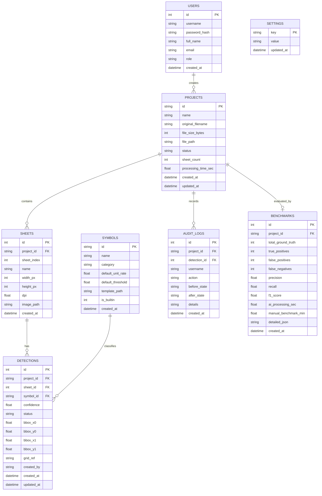

# Data Model — ElectroScan AI

SQLite persistent store: `data/electroscan.db`

---

## Entity Relationship Diagram (Mermaid)

---

## Detailed Table Specifications

### 1. `users`
- `id` (INTEGER, PRIMARY KEY AUTOINCREMENT)
- `username` (TEXT, UNIQUE, NOT NULL)
- `password_hash` (TEXT, NOT NULL)
- `full_name` (TEXT, NOT NULL)
- `email` (TEXT, NOT NULL)
- `role` (TEXT, NOT NULL DEFAULT 'Estimator')
- `created_at` (DATETIME, NOT NULL DEFAULT CURRENT_TIMESTAMP)

### 2. `projects`
- `id` (TEXT, PRIMARY KEY)
- `name` (TEXT, NOT NULL)
- `original_filename` (TEXT, NOT NULL)
- `file_size_bytes` (INTEGER, NOT NULL)
- `file_path` (TEXT, NOT NULL)
- `status` (TEXT, NOT NULL DEFAULT 'queued') — `queued`, `processing`, `completed`, `failed`
- `sheet_count` (INTEGER NOT NULL DEFAULT 0)
- `processing_time_sec` (REAL DEFAULT 0.0)
- `created_at` (DATETIME, DEFAULT CURRENT_TIMESTAMP)
- `updated_at` (DATETIME, DEFAULT CURRENT_TIMESTAMP)

### 3. `sheets`
- `id` (INTEGER, PRIMARY KEY AUTOINCREMENT)
- `project_id` (TEXT, NOT NULL, REFERENCES projects(id) ON DELETE CASCADE)
- `sheet_index` (INTEGER, NOT NULL)
- `name` (TEXT, NOT NULL)
- `width_px` (INTEGER, NOT NULL)
- `height_px` (INTEGER, NOT NULL)
- `dpi` (REAL NOT NULL DEFAULT 150.0)
- `image_path` (TEXT, NOT NULL)
- `created_at` (DATETIME, DEFAULT CURRENT_TIMESTAMP)

### 4. `symbols`
- `id` (TEXT, PRIMARY KEY) — e.g., `lighting_fixture`, `power_outlet`, `switch`
- `name` (TEXT, NOT NULL)
- `category` (TEXT, NOT NULL DEFAULT 'Electrical')
- `default_unit_rate` (REAL NOT NULL DEFAULT 0.0)
- `default_threshold` (REAL NOT NULL DEFAULT 0.80)
- `template_path` (TEXT, NOT NULL)
- `is_builtin` (INTEGER NOT NULL DEFAULT 1)
- `created_at` (DATETIME, DEFAULT CURRENT_TIMESTAMP)

### 5. `detections`
- `id` (INTEGER, PRIMARY KEY AUTOINCREMENT)
- `project_id` (TEXT, NOT NULL, REFERENCES projects(id) ON DELETE CASCADE)
- `sheet_id` (INTEGER, NOT NULL, REFERENCES sheets(id) ON DELETE CASCADE)
- `symbol_id` (TEXT, NOT NULL, REFERENCES symbols(id))
- `confidence` (REAL NOT NULL) — 0.00 to 1.00
- `status` (TEXT, NOT NULL) — `auto`, `flagged`, `kept`, `rejected`, `manual`
- `bbox_x0` (REAL NOT NULL) — normalized [0.0, 1.0]
- `bbox_y0` (REAL NOT NULL)
- `bbox_x1` (REAL NOT NULL)
- `bbox_y1` (REAL NOT NULL)
- `grid_ref` (TEXT, NOT NULL) — e.g. "B-4", calculated by column (A-L) and row (1-8)
- `created_by` (TEXT NOT NULL DEFAULT 'ai') — 'ai' or username
- `created_at` (DATETIME, DEFAULT CURRENT_TIMESTAMP)
- `updated_at` (DATETIME, DEFAULT CURRENT_TIMESTAMP)

### 6. `audit_logs`
- `id` (INTEGER, PRIMARY KEY AUTOINCREMENT)
- `project_id` (TEXT, NOT NULL, REFERENCES projects(id) ON DELETE CASCADE)
- `detection_id` (INTEGER, REFERENCES detections(id) ON DELETE SET NULL)
- `username` (TEXT, NOT NULL)
- `action` (TEXT, NOT NULL) — `KEEP_DETECTION`, `REJECT_DETECTION`, `CHANGE_TYPE`, `MANUAL_ADD`, `THRESHOLD_UPDATE`
- `before_state` (TEXT)
- `after_state` (TEXT)
- `details` (TEXT, NOT NULL)
- `created_at` (DATETIME, DEFAULT CURRENT_TIMESTAMP)

### 7. `benchmarks`
- `id` (INTEGER, PRIMARY KEY AUTOINCREMENT)
- `project_id` (TEXT, NOT NULL, UNIQUE, REFERENCES projects(id) ON DELETE CASCADE)
- `total_ground_truth` (INTEGER NOT NULL)
- `true_positives` (INTEGER NOT NULL)
- `false_positives` (INTEGER NOT NULL)
- `false_negatives` (INTEGER NOT NULL)
- `precision` (REAL NOT NULL)
- `recall` (REAL NOT NULL)
- `f1_score` (REAL NOT NULL)
- `ai_processing_sec` (REAL NOT NULL)
- `manual_benchmark_min` (REAL NOT NULL)
- `detailed_json` (TEXT NOT NULL)
- `created_at` (DATETIME, DEFAULT CURRENT_TIMESTAMP)

### 8. `settings`
- `key` (TEXT, PRIMARY KEY)
- `value` (TEXT, NOT NULL)
- `updated_at` (DATETIME, DEFAULT CURRENT_TIMESTAMP)
